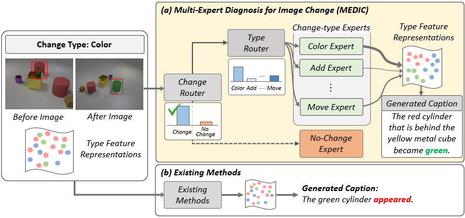
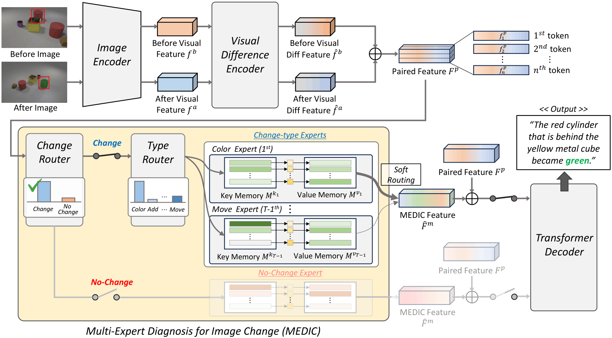
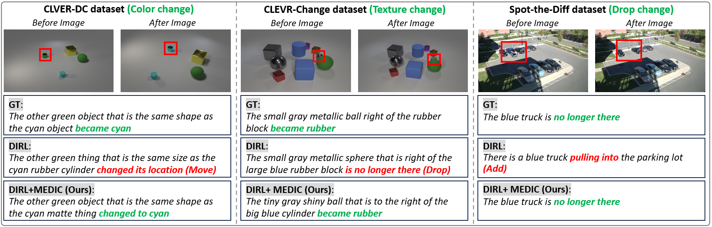
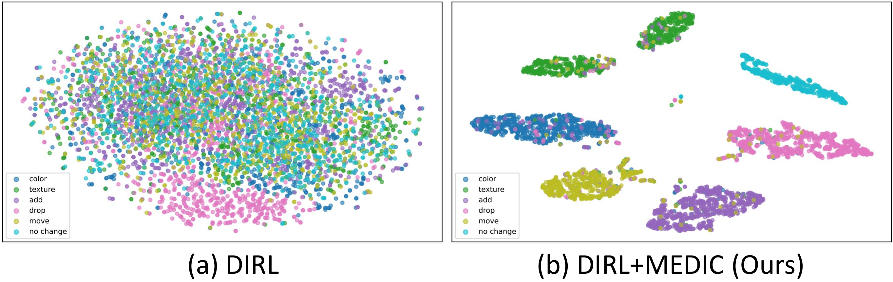
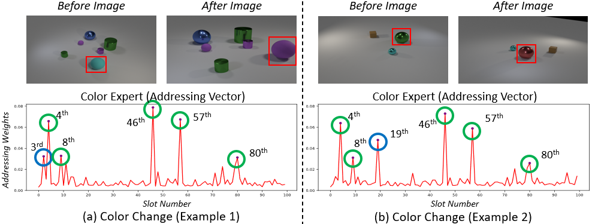

<h1>MEDIC</h1>
<h3>Different Changes Require Different Reasoning:<br>Change-Type-Specialized Experts for Robust Change Captioning</h3>

<a href="https://orcid.org/0009-0000-4212-7745"><strong>Jiyoung Park</strong></a><sup>1,*</sup>
· <a href="https://orcid.org/0009-0001-1321-3019"><strong>InJae Oh</strong></a><sup>1,*</sup>
· <a href="https://orcid.org/0000-0003-4533-4875"><strong>Jung Uk Kim</strong></a><sup>1,†</sup>

<sup>1</sup>Kyung Hee University, Yong-in, South Korea

<sup>*</sup> Equal contribution, <sup>†</sup> Corresponding author

Accepted to ECCV 2026!

<div align="center">

   
<!-- []()&nbsp; -->

<!-- []()&nbsp; -->

<!-- []() -->

</div>

---

## Table of Contents

* [Abstract](#abstract)
* [Overview](#overview)
* [Qualitative and Analytical Results](#qualitative-and-analytical-results)
* [Getting Started](#getting-started)
* [Data Preparation](#data-preparation)
* [Training and Evaluation](#training-and-evaluation)
* [Results](#results)
* [Plug-in Usage](#plug-in-usage)
* [Acknowledgement](#acknowledgement)
* [Citation](#citation)

## Abstract

Change captioning aims to generate natural language descriptions that explain semantic differences between a pair of images. Although different change types, such as color shifts, object additions, object removals, and spatial movements, require different visual evidence and reasoning processes, existing methods often process all changes through a single type-agnostic pipeline.

To address this limitation, we propose **Multi-Expert Diagnosis for Image Change (MEDIC)**, a change-type-aware framework for robust change captioning. MEDIC introduces a two-stage routing mechanism that first determines whether a meaningful change exists and then assigns the input to change-type-specialized experts. Each expert is implemented as a key-value memory network, enabling input-adaptive retrieval of type-relevant visual patterns. By explicitly modeling change-type diversity, MEDIC improves the precision and robustness of change descriptions across diverse datasets.

MEDIC is designed as a plug-in module and can be integrated into existing change captioning models. In our paper, we apply MEDIC to representative baselines including DIRL, SMART, and SCORER.

<div align="center">

</div>

## Overview

MEDIC consists of two main components:

1. **Two-stage router**  
   The router first predicts whether a change exists and then estimates the distribution over change types.

2. **Change-type memory experts**  
   Each expert is specialized for a specific change type and retrieves type-relevant visual patterns through a key-value memory network.

The current release provides the official implementation of **DIRL + MEDIC**. MEDIC is implemented as a plug-in module, and additional integrations for other baselines will be updated.

Current release:

* Core MEDIC module
* DIRL + MEDIC training and evaluation code
* Configurations for CLEVR-DC, CLEVR-Change, Spot-the-Diff, and Image Editing Request
* Evaluation scripts

## Qualitative and Analytical Results

### Qualitative Results

<div align="center">

</div>

### t-SNE Analysis

<div align="center">

</div>

### Memory Slot Activation

<div align="center">

</div>

## Getting Started

Follow the steps below to set up the environment and run MEDIC.

```bash
git clone https://github.com/VisualAIKHU/MEDIC.git
cd MEDIC
